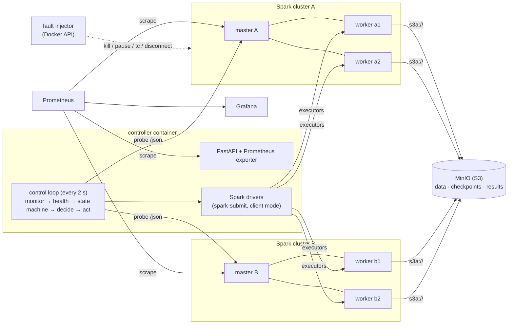

# RMC-Spark — Resilient Multi-Cluster Spark Analytics

Implementation for the paper **"Resilient Data Science Programming for Fault-Tolerant Distributed
Analytics in Multi-Cluster Spark Environments"** (Programming for Data Science, MACSE502, VIT —
Team 26FSPDSCPMID4098).

RMC-Spark adds a resilience layer above several independent Apache Spark clusters:

| # | Component | What it does | Code |
|---|---|---|---|
| C1 | Health monitor + anomaly detection | Probes every Spark master and every running driver, scores 5 signals, computes a health score `H_k` | `controller/monitor.py`, `anomaly.py`, `health.py` |
| C2 | Adaptive checkpointing | Checkpoints a stage once the un-saved work reaches the Young/Daly optimum interval `τ*`, computed from the observed MTBF | `rds/policy.py`, `rds/stage.py` |
| C3 | Cross-cluster failover | A health state machine detects a failed cluster; a job that stopped making progress is moved to another cluster and **resumes from its last committed stage** | `controller/statemachine.py`, `jobs.py`, `core.py` |
| C4 | Workload orchestrator | Places and re-places jobs with a cost `J_k` built from load, health and data transfer | `controller/orchestrator.py` |
| C5 | Explainable reliability | Every detection/failover/keep decision is logged with its cause; each cluster gets a reliability score `R_k` with per-component contributions | `controller/decisions.py`, `reliability.py` |
| — | `rds` library | `@pipe.stage(...)` makes PySpark stages idempotent and resumable on **any** cluster | `rds/` |
| — | Fault injector | 9 fault types, scripted and repeatable (chaos engineering) | `chaos/inject.py` |
| — | Experiment harness + analysis | Runs systems × workloads × faults × repetitions; produces Tables 11–12 and Figures 21–24 at 600 DPI | `experiments/`, `analysis/` |

> **Status.** All code is written and the decision logic is covered by 56 unit/simulation tests
> (`pytest`, all passing). The Docker testbed has **not yet been run end-to-end**, and there are
> **no measured results yet**. Every number in the paper must come from `results/` after you run the
> experiments below.

---

## Contents
1. [Architecture](#1-architecture)
2. [Repository layout](#2-repository-layout)
3. [Prerequisites](#3-prerequisites)
4. [Step-by-step: run it](#4-step-by-step-run-it)
5. [Writing resilient jobs with `rds`](#5-writing-resilient-jobs-with-rds)
6. [How the controller decides (equations)](#6-how-the-controller-decides)
7. [Faults](#7-fault-catalogue)
8. [Systems compared and the experiment matrix](#8-systems-compared-and-the-experiment-matrix)
9. [Metrics](#9-metrics)
10. [Mapping to the paper](#10-mapping-to-the-paper)
11. [Recording the execution videos](#11-recording-the-execution-videos)
12. [Troubleshooting](#12-troubleshooting)
13. [Limitations (state these in the paper)](#13-limitations)
14. [Team ownership](#14-team-ownership)

---

## 1. Architecture



**Why drivers live in the controller container.** In client mode the driver is not inside the
cluster, so a whole-cluster outage cannot take the driver with it. The controller sees the outage,
kills the stuck driver and starts a new one against the other cluster. Because every stage checkpoint
is in shared MinIO storage, the new attempt **restores** the committed stages instead of recomputing
them.

**What a failover looks like (cluster outage on A):**

```
t0        fault: master A + workers killed
t0+2..6s  probe of master A fails 3 times → H_A ≈ 0.30 < 0.50 → state FAILED (reason logged)
          driver on A reports no completed tasks any more (stall)
t0+~16s   stall ≥ 10 s on a FAILED cluster → kill driver, place job: argmin J_k → B
          spark-submit --master spark://spark-master-b:7077 ... --attempt 1
          rds: stage "clean" committed → restored, "enrich" committed → restored, "hourly_agg" → computed
end       job SUCCEEDED, decisions.jsonl explains every step
```

---

## 2. Repository layout

```
rmc-spark/
├── docker-compose.yml          testbed: 2 Spark clusters, MinIO, Prometheus, Grafana, controller
├── docker/                     Dockerfile, spark-defaults.conf, metrics.properties, prometheus.yml, grafana/
├── configs/clusters.yaml       cluster registry + EVERY controller threshold (→ Table 6)
├── rds/                        Resilient Data Science library (runs inside the Spark driver)
│   ├── policy.py               never / always / adaptive (Young-Daly) checkpoint policies
│   ├── stage.py                ResilientPipeline + @stage decorator, commit protocol, resume
│   ├── events.py               JSONL stage events
│   └── cli.py                  common job arguments passed by the controller
├── controller/                 resilience controller
│   ├── monitor.py              Spark master + driver REST probes
│   ├── anomaly.py              EWMA z-score detector
│   ├── health.py               H_k and per-signal contributions
│   ├── statemachine.py         HEALTHY/SUSPECT/FAILED (proposed) + timeout detector (baseline B3)
│   ├── orchestrator.py         placement cost J_k
│   ├── reliability.py          availability, MTTR, MTBF estimate, reliability score R_k
│   ├── jobs.py                 spark-submit process management + recovery decisions
│   ├── core.py                 the control loop
│   ├── decisions.py            explainable decision log
│   ├── api.py / cli.py         REST API, Prometheus metrics, command-line client
│   └── workloads.py            workload catalogue
├── jobs/                       PySpark workloads
│   ├── datagen.py              synthetic taxi trips + skewed graph
│   ├── etl_taxi.py             W1 batch ETL (clean → enrich → aggregate → rank)
│   ├── ml_pipeline.py          W2 MLlib GBT pipeline (+ case studies ai4i / creditcard)
│   ├── iterative_rank.py       W3 PageRank, long lineage (12 iterations)
│   ├── streaming_rate.py       W4 Structured Streaming with checkpointed state
│   └── ingest_local.py         copy downloaded datasets into MinIO
├── chaos/inject.py             fault injector (CLI + library)
├── experiments/                run_matrix.py + configs/{smoke,full}.yaml
├── analysis/                   metrics.py, stats.py, report.py (tables + 600-DPI figures)
├── scripts/download_data.py    NYC TLC, AI4I 2020, credit-card datasets
├── datasets/README.md          dataset sources, licences, data-availability statement
├── tests/                      56 unit + simulation tests (no Docker or Spark needed)
└── results/                    everything the experiments produce
```

---

## 3. Prerequisites

| Need | Version / size | Notes |
|---|---|---|
| Windows 10/11 with WSL2, or Linux/macOS | — | developed on Windows 11, 12 logical CPUs, 16 GB RAM |
| Docker Desktop | ≥ 4.x (Engine ≥ 24) | must be **running** |
| Free RAM for Docker | **12 GB** | container limits add up to ≈ 11.5 GB |
| Disk | ≈ 6 GB | Spark image ≈ 1 GB + 280 MB AWS SDK jar, MinIO data, results |
| Internet (first build only) | ≈ 1.5 GB download | Docker Hub images + Maven Central jars |
| Python on the host | 3.10+ (optional) | only to run the unit tests outside Docker |

You do **not** need Java, Spark or PySpark on the host: everything runs inside the containers (Spark 3.5.3,
Java 17, Python 3.10).

---

## 4. Step-by-step: run it

All commands work in PowerShell and in bash. Run them from the `rmc-spark` folder.

### Step 1 — give Docker 12 GB of RAM (Windows/WSL2)

Create `C:\Users\<you>\.wslconfig` with:

```ini
[wsl2]
memory=12GB
processors=10
```

Then restart WSL and Docker Desktop:

```bash
wsl --shutdown
```

(On macOS/Linux Docker Desktop: Settings → Resources → Memory = 12 GB.)

### Step 2 — build the image and start the testbed

```bash
docker compose build
```

```bash
docker compose up -d
```

```bash
docker compose ps
```

All services should be `running`, and `rmc-minio-init` should be `exited (0)`: it creates the buckets
`data`, `checkpoints` and `results` and then exits.

### Step 3 — check the web UIs

| UI | URL | Expect |
|---|---|---|
| Spark master A | <http://localhost:8080> | 2 workers ALIVE, 4 cores |
| Spark master B | <http://localhost:8090> | 2 workers ALIVE, 4 cores |
| Controller API | <http://localhost:8000/docs> | Swagger page |
| Controller metrics | <http://localhost:8000/metrics> | `rmc_cluster_health{cluster="A"} 1.0` |
| MinIO console | <http://localhost:9001> | login `rmcadmin` / `rmcadmin123` |
| Prometheus | <http://localhost:9090/targets> | targets UP |
| Grafana | <http://localhost:3000> | dashboard *RMC-Spark → Resilience Overview* |

```bash
docker compose exec controller python -m controller.cli status
```

### Step 4 — generate the data (once, about 2–4 minutes)

```bash
docker compose exec controller spark-submit --master spark://spark-master-a:7077 --conf spark.driver.host=controller --total-executor-cores 4 --executor-memory 576m jobs/datagen.py
```

Optional real datasets: NYC TLC for `etl_taxi --source tlc`, and the two case studies for Section 18.

```bash
docker compose exec controller python scripts/download_data.py --tlc-months 2024-01 --case-studies
```

```bash
docker compose exec controller spark-submit --master spark://spark-master-a:7077 --conf spark.driver.host=controller --total-executor-cores 4 --executor-memory 576m jobs/ingest_local.py
```

### Step 5 — run one job and break its cluster (live demo)

```bash
docker compose exec controller python -m controller.cli submit etl_taxi --mode smart --policy adaptive
```

Wait about 40 s (watch the job in <http://localhost:8080>), then:

```bash
docker compose exec controller python -m controller.cli chaos cluster_outage --cluster A
```

```bash
docker compose exec controller python -m controller.cli status
```

```bash
docker compose exec controller python -m controller.cli decisions --limit 20
```

You should see: A → `SUSPECT` → `FAILED` (with cause `unreachable`), a `failover` decision to B
(`argmin J -> B`), and the job `SUCCEEDED` on B with `stage_restored` events in
`results/events/<job_id>.jsonl`. Bring A back with:

```bash
docker compose exec controller python -m controller.cli restore
```

### Step 6 — smoke experiment (about 15–20 min)

Compares vanilla Spark (B1) with RMC-Spark (P) on `etl_taxi`, without a fault and with a cluster outage.

```bash
docker compose exec controller python -m experiments.run_matrix experiments/configs/smoke.yaml
```

Expected outcome: B1 + `cluster_outage` → `FAILED` (deadline), P + `cluster_outage` → `SUCCEEDED` on `A>B`.
If this works, the testbed is ready.

### Step 7 — calibrate and run the full matrix

1. Measure the clean runtime of each workload on **your** machine. The fault-free runs in the smoke
   test give the ETL time; submit the others once with `controller.cli submit`.
2. In `experiments/configs/full.yaml`, set `fault_at_s` ≈ 40 % of each clean runtime and
   `expected_runtime_s` to the measured value.
3. Preview the matrix size and estimated time:

```bash
docker compose exec controller python -m experiments.run_matrix experiments/configs/full.yaml --dry-run
```

4. Start it (5 systems × 4 workloads × 8 fault settings × 3 repetitions = 480 runs; plan for a day or
   more, and you can lower `repetitions` or the fault list). It appends to `results/raw/full/runs.csv`,
   so an interrupted matrix can be continued by editing the config. While it runs, do **not**
   submit jobs or inject faults through the API: the runner owns the driver UI ports 4040–4049 and the
   clusters.

```bash
docker compose exec -d controller python -m experiments.run_matrix experiments/configs/full.yaml
```

```bash
docker compose exec controller tail -f results/raw/full/runs.csv
```

### Step 8 — produce the tables and figures

```bash
docker compose exec controller python -m analysis.report results/raw/full --out results/report
```

Creates in `results/report/`:
`Table 11 Experimental Results Summary.{csv,md}`, `Table 12 Comparative Benchmark Analysis.{csv,md}`,
`Table S1 Streaming Recovery`, `Fig 21 Fault Recovery Performance.png`,
`Fig 22 Availability and Success Rate.png`, `Fig 23 Resource Utilization and Cluster Stability.png`,
`Fig 24 Comparative Benchmark Radar.png` (all 600 DPI), plus `runs_enriched.csv` with every derived metric.

### Step 9 — run the tests

Inside the container:

```bash
docker compose exec controller python -m pytest
```

Or on the host (needs only `pytest` and `requests`):

```bash
python -m pytest
```

### Stop / clean up

```bash
docker compose down
```

Add `-v` to also delete the MinIO volume, i.e. all data and checkpoints:

```bash
docker compose down -v
```

---

## 5. Writing resilient jobs with `rds`

```python
from rds import ResilientPipeline, base_parser, context_from_args

args = base_parser("my job").parse_args()        # --job-id --attempt --cluster --policy --mtbf ...
ctx = context_from_args(args)
spark = SparkSession.builder.getOrCreate()
pipe = ResilientPipeline(spark, ctx)               # linear=True for single-chain jobs (iterations)

@pipe.stage("clean")
def clean(df):
    return df.where("fare_amount > 0")

@pipe.stage("train", kind="model", loader=GBTRegressionModel)
def train(df):
    return GBTRegressor(...).fit(df)

model = train(clean(spark.read.parquet("s3a://data/taxi_synth")))
pipe.finish(status="ok")
```

What a stage does:
1. If `<checkpoint_root>/<job_id>/<stage>/_RDS_COMMIT` exists, it **restores** the stage output and
   skips the computation. This is how a job resumes after moving to another cluster.
2. Otherwise it runs the function, persists and materialises the result, and adds its compute time
   to the **un-checkpointed work** `W`.
3. It asks the policy whether to checkpoint now:
   - `never`: lineage only, like vanilla Spark.
   - `always`: after every stage.
   - `adaptive`: when `W ≥ τ*`.
4. When it checkpoints, it writes the data first and the commit marker second. A crash in between
   leaves no marker, so half-written output is never read back. Reading the data back also truncates
   the lineage.
5. Each step is written as an event (`stage_started`, `stage_completed`, `stage_restored`,
   `stage_skipped`) with timings to `results/events/<job_id>.jsonl`.

Rules for job authors: stage names must be unique and stable, and stages must be deterministic
(seeded randomness), so a re-run produces the same result. Use `linear=True` only when each stage
consumes just the previous one. Then the stages before the latest committed one are skipped instead
of recomputed.

---

## 6. How the controller decides

| Eq. | Quantity | Formula | Where |
|---|---|---|---|
| (1) | Availability | `A = MTBF / (MTBF + MTTR)`; per run `A = 1 − downtime / duration` | `analysis/metrics.py` |
| (2) | Recovery / downtime | `T_rec = t_resume − t_fault` | `analysis/metrics.py` |
| (3) | Optimal checkpoint interval | Young: `τ* = √(2CM)`; Daly: `τ* = √(2CM)·[1 + ⅓√(C/2M) + (C/2M)/9] − C` | `rds/policy.py` |
| (4) | Expected lost work | `W_lost ≈ τ/2 + C` | `rds/policy.py` |
| (5) | Overhead | `O = (T_system,clean − T_B1,clean) / T_B1,clean` | `analysis/metrics.py` |
| (6) | Core utilisation | `U = Σ cores_used·Δt / Σ cores·Δt` | `analysis/metrics.py` |
| (7) | Anomaly z-score | `z_t = (x_t − μ_{t−1}) / σ_{t−1}` (EWMA), `a = ramp(|z|, 3, 8)` | `controller/anomaly.py` |
| (8) | Health | `H_k = 1 − Σ_i w_i a_{i,k}` | `controller/health.py` |
| (9) | Placement cost | `J_k = α·load_k + β·(1 − H_k) + γ·transfer_k` | `controller/orchestrator.py` |
| (10) | Reliability score | `R_k = Σ_j w_j s_j`, s = {availability, recovery, success, health} | `controller/reliability.py` |
| (11) | MTBF estimate | `M = (M₀·n₀ + uptime) / (n₀ + failures)` | `controller/reliability.py` |

**Health signals and weights** (`configs/clusters.yaml`; report these values as Table 6):

| Signal | Weight | Anomaly a = 1 when |
|---|---|---|
| unreachable | 0.45 | master `/json` does not answer within 1.5 s |
| workers_lost | 0.25 | no alive workers (linear in the fraction lost) |
| latency | 0.10 | probe-latency EWMA z-score ≥ 8 (gray failure) |
| stall | 0.15 | no completed task for 120 s while a job runs |
| executor_loss | 0.05 | all executors of the running job lost |

Override: a reachable master with **0 workers** sets `H = 0` (no capacity).

**State machine.**
- `SUSPECT` when H < 0.95. A fully anomalous latency or stall signal alone only reaches SUSPECT.
- `FAILED` after 3 consecutive polls with H < 0.50 (about 6 s).
- Back to `HEALTHY` after 5 consecutive polls with H ≥ 0.95.

**Recovery rules** (`controller/jobs.py`):

| Situation | none (B1/B2) | naive (B3) | smart (P) |
|---|---|---|---|
| Driver exits non-zero, cluster healthy | job FAILED | rerun on passive cluster | **retry on same cluster** (resumes from checkpoints), then fail over |
| Cluster FAILED, job still progressing (e.g. only the master died) | keeps running | **migrates anyway** (unneeded restart) | **keeps the job**, logs a `keep` decision |
| Cluster FAILED, job stalled ≥ 10 s | hangs until deadline → FAILED | migrates after 30 s timeout | migrates to `argmin J_k` |
| New job | cluster A | cluster A | `argmin J_k` |

---

## 7. Fault catalogue

| Fault | How it is injected | Realistic analogue | Transient? |
|---|---|---|---|
| `executor_kill` | `pkill -9 CoarseGrainedExecutorBackend` on one worker | JVM OOM / crash | instant |
| `worker_kill` | `docker kill` one worker | node crash | until restore |
| `master_kill` | `docker kill` the master | control-plane failure | until restore |
| `cluster_outage` | `docker kill` master + all workers | zone / data-centre outage | until restore |
| `network_partition` | `docker network disconnect` all cluster containers | network split | 60 s |
| `network_delay` | `tc qdisc ... netem delay 300ms 50ms` | congested / degraded link | 60 s |
| `straggler` | `docker update --cpu-quota` 0.25 CPU on one worker | noisy neighbour / slow node | 60 s |
| `disk_full` | `fallocate` fills the 1 GB Spark local-dir tmpfs | disk exhaustion | 60 s |
| `driver_crash` | SIGKILL the driver process | driver bug / OOM | instant |

From the command line:

```bash
docker compose exec controller python -m chaos.inject network_delay --cluster A --duration 60
```

```bash
docker compose exec controller python -m chaos.inject restore
```

---

## 8. Systems compared and the experiment matrix

| Id | Recovery mode | Checkpoint policy | Extra Spark conf | Role |
|---|---|---|---|---|
| **B1_vanilla** | none | never | — | standard Spark deployment |
| **B2_fixed_ckpt** | none | always | — | Spark with fixed checkpointing |
| **B3_naive_ha** | naive (30 s timeout, active/passive) | never | — | typical HA script |
| **A1_rmc_no_adapt** | smart | always | `spark.speculation=true` | ablation: shows what the adaptive policy adds |
| **P_rmc** | smart | adaptive (Daly) | `spark.speculation=true` | proposed system |

> Fairness note for the paper: P and A1 also turn on Spark's speculative execution, which helps with
> stragglers. Say so explicitly. If you want to isolate that effect, add a `B1 + speculation` system
> to `full.yaml`.

Workloads: `etl_taxi` (W1), `ml_taxi` (W2), `iterative_rank` (W3), `streaming` (W4).
Fault settings: `none` plus 7 faults. Every run starts on cluster A, and the fault hits the job's
current cluster at `fault_at_s`. Runs are shuffled within each repetition (seed 2026).

Comparing with published work, e.g. Vogel et al. (DEBS 2024), *A Comprehensive Benchmarking Analysis
of Fault Recovery in Stream Processing Frameworks*: their numbers come from AWS EKS hardware, so do
**not** put them in the same table as yours. The streaming recovery metric here uses the same rule
(throughput back to ≥ 85 % of the pre-fault mean and staying there for 40 s), so you may compare
*behaviour* qualitatively. All quantitative claims are against B1–B3 measured on this testbed.

---

## 9. Metrics

| Metric | Definition | Column in `runs_enriched.csv` |
|---|---|---|
| Job success rate | completed before the deadline | `success` |
| Completion time | submit → end | `duration_s` |
| Fault-induced delay | completion time − median clean completion of the same system | `delay_s` |
| Downtime | failed: `t_end − t_fault`; succeeded: `max(0, delay)` | `downtime_s` |
| Run availability | `1 − downtime/duration` | `availability` |
| Detection latency | fault → cluster marked FAILED by that system's detector | `detection_s` |
| Failover latency | fault → new driver submitted | `failover_s` |
| Recomputed work | stage compute time repeated by later attempts | `recomputed_s` |
| Checkpoint cost | total checkpoint write time, number of checkpoints | `checkpoint_s`, `checkpoints` |
| Fault-free overhead | Eq. (5) | `overhead` |
| Streaming recovery | rule above | `stream_recovery_s` |
| Utilisation | Eq. (6) from `cluster_timeseries.csv` | figure 23 |

Statistics (`analysis/stats.py`): runs are independent, so the analysis uses Mann–Whitney U
(two-sided), Cliff's δ with magnitude labels, and 95 % bootstrap confidence intervals.

---

## 10. Mapping to the paper

| Paper section | Implementation / evidence |
|---|---|
| 5 Architecture (Fig. 6, 7) | §1 of this README, `docker-compose.yml` |
| 6 Data engineering (Fig. 8, Table 5) | `jobs/`, `rds/stage.py` commit protocol, MinIO buckets |
| 7 Spark execution (Fig. 9, 10, Eq. 6) | DAGs of `jobs/*` (Spark UI), utilisation from timeseries |
| 8 Fault detection (Fig. 11, 12, Table 6) | `controller/monitor.py`, `anomaly.py`, `health.py`, thresholds in `configs/clusters.yaml` |
| 9 Recovery (Fig. 13, 14, Eq. 3–4) | `rds/policy.py`, `rds/stage.py`, `controller/jobs.py` |
| 10 Coordination (Fig. 15, 16, Eq. 9) | `controller/orchestrator.py`, `core.py` |
| 11 Explainability (Fig. 17, Table 7, Eq. 10) | `decisions.jsonl`, `/clusters` reliability contributions |
| 12 Security & governance (Table 8) | §13 below — be explicit about what is implemented vs designed |
| 13 Experimental setup (Fig. 19, Table 9) | `docker-compose.yml`, `configs/`, `experiments/configs/full.yaml`, `results/raw/full/experiment.json` |
| 14 Metrics (Table 10) | §9 |
| 15–16 Results & comparison (Fig. 21–24, Tables 11–12) | `analysis/report.py` output |
| 18 Industry case studies | workloads `case_maintenance` (AI4I 2020) and `case_fraud` (credit card) |

---

## 11. Recording the execution videos

Record the screen (e.g. OBS Studio) with four windows: the Grafana dashboard, Spark master A and B
UIs, and a terminal. Suggested clips:
1. `docker compose up -d` and every UI coming up.
2. `datagen` running.
3. Live failover: Step 5, with Grafana showing H_A dropping and the state changing to FAILED.
4. `controller.cli decisions` showing the explanations.
5. The smoke experiment finishing and `analysis.report` producing the figures.

---

## 12. Troubleshooting

| Symptom | Fix |
|---|---|
| `error during connect ... dockerDesktopLinuxEngine` | Docker Desktop is not running: start it |
| Containers exit with code 137 | out of memory: Step 1 (12 GB), or lower worker `mem_limit` and `--memory` |
| Spark UI shows 0 workers after a restore | wait 10–20 s; otherwise run `docker compose restart spark-worker-a1 spark-worker-a2` |
| Job stuck in `WAITING` | no healthy cluster: `python -m controller.cli restore` |
| `ClassNotFoundException S3AFileSystem` | image built without the jars: `docker compose build --no-cache` |
| `Address already in use :4040` | a previous driver still runs: `docker compose restart controller` |
| `tc: command not found` / `Operation not permitted` | rebuild the image (iproute2) and keep `cap_add: NET_ADMIN` |
| Streaming job ends instantly on a re-run with an old id | delete `s3a://checkpoints/<job_id>` in the MinIO console |

---

## 13. Limitations

State these in the paper (Section 20):

- **Single physical host.** The clusters are containers on one laptop. A real outage of the host
  takes everything down, and network effects are emulated with `tc`/disconnect.
- **Controller and MinIO are single points of failure** in this testbed. Production would run
  several controller replicas with leader election, and replicated or multi-region object storage.
- **Driver placement.** Drivers run in the controller container (client mode). This protects them
  from cluster outages but concentrates driver memory on one host.
- **At-least-once stage execution.** A migrated attempt can overlap briefly with the old one if the
  old cluster comes back. Stage writes are idempotent (`overwrite` + commit marker), but external side
  effects would need deduplication.
- **Security.** Lab credentials, no TLS, and containers run as root (needed for `tc`). Spark
  authentication (`spark.authenticate`), TLS, MinIO IAM policies and non-root images are the
  production hardening to describe in Section 12. Report them as *designed*, not *implemented*, unless
  you enable them.
- Thresholds were set by reasoning, not tuned, and are all listed in `configs/clusters.yaml`.
  Sensitivity analysis is future work.

---

## 14. Team ownership

| Member | Implementation | Paper sections |
|---|---|---|
| 26MML0015 (PoC) | `controller/core.py`, `jobs.py`, `orchestrator.py`, integration | Exec summary, 5, 9, 10, 20, 22 |
| 26MML0054 | `monitor.py`, `anomaly.py`, `health.py`, `reliability.py`, `analysis/` | Keywords, 8, 11, 14, 15, 19, 21 |
| 26MML0006 | `docker/`, `jobs/`, `rds/`, `chaos/`, running experiments | 2, 4, 6, 7, 13, 16 |
| 26MML0047 | literature, `datasets/`, security hardening, case studies | 1, 3, 12, 17, 18 |

### Method references used directly by the code
- J. W. Young, "A first order approximation to the optimum checkpoint interval," *Commun. ACM*, 17(9), 1974. doi:10.1145/361147.361115
- J. T. Daly, "A higher order estimate of the optimum checkpoint interval for restart dumps," *Future Gener. Comput. Syst.*, 22(3), 2006. doi:10.1016/j.future.2004.11.016
- M. Zaharia et al., "Resilient Distributed Datasets: A Fault-Tolerant Abstraction for In-Memory Cluster Computing," NSDI 2012.
- A. Vogel et al., "A Comprehensive Benchmarking Analysis of Fault Recovery in Stream Processing Frameworks," ACM DEBS 2024. doi:10.1145/3629104.3666040
- A. Basiri et al., "Chaos Engineering," *IEEE Software*, 33(3), 2016. doi:10.1109/MS.2016.60
